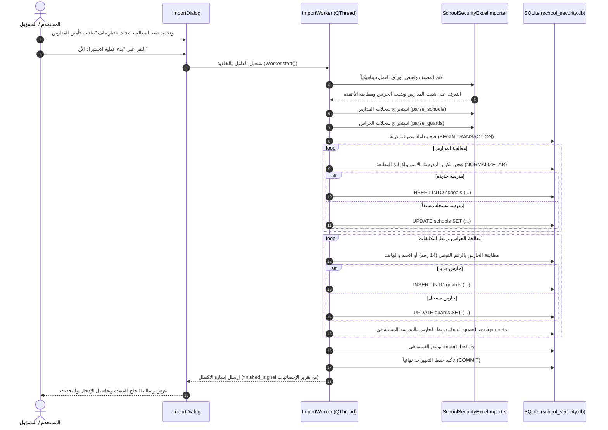
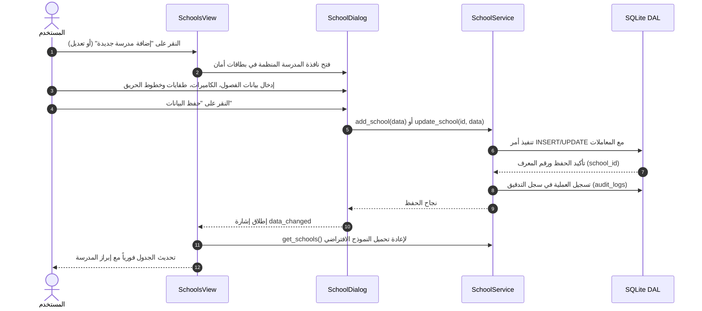
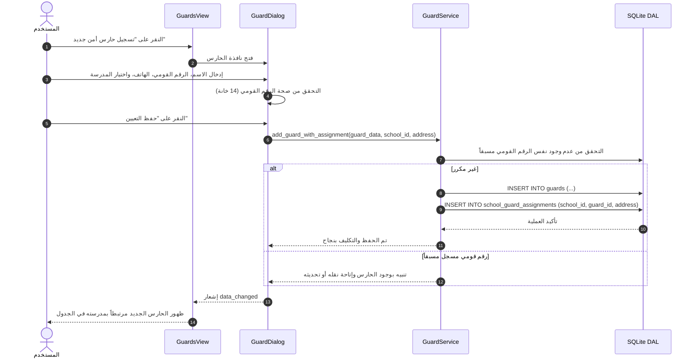
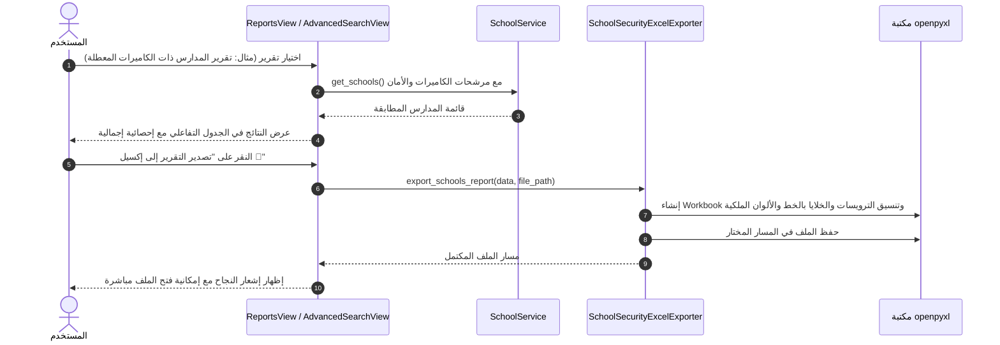

# 🔄 مخططات تدفق البيانات (Data Flow & Sequence Diagrams)
## العمليات الأساسية في منظومة تأمين المدارس وحراس الأمن

يوضح هذا المستند بالتسلسل الزمني الدقيق كيفية معالجة وتدفق البيانات بين مختلف المكونات أثناء تنفيذ العمليات الحيوية للنظام.

---

### 1. تدفق عملية استيراد كشوف الإكسيل التلقائية (Excel Bulk Import Flow)

---

### 2. تدفق إضافة وتعديل بيانات مدرسة وتجهيزات الأمان (School Management Flow)

---

### 3. تدفق تسجيل وتعيين حارس أمن وتفادي التكرار (Guard Assignment Flow)

---

### 4. تدفق البحث المتقدم والتقارير التحليلية والتصدير (Search & Reports Flow)

