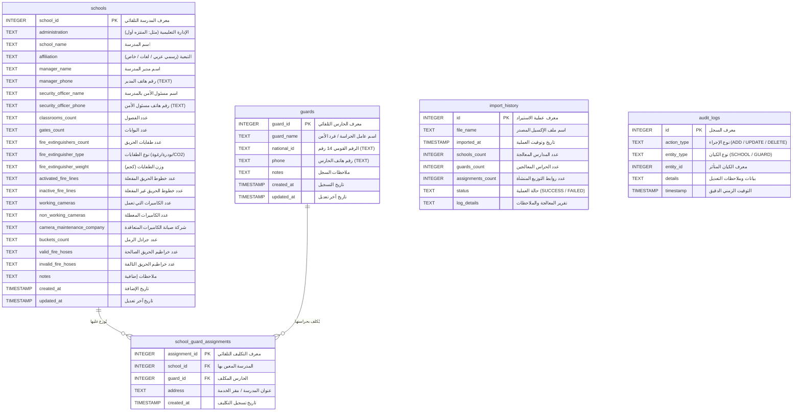
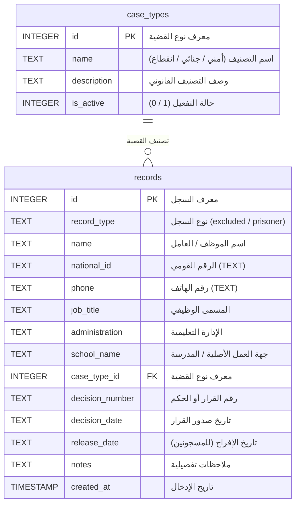

# 🗄️ المخطط العلائقي لقواعد البيانات (Database Entity-Relationship Diagram)
## التطبيق المكتبي الموحد — مديرية التربية والتعليم بالإسكندرية

تعتمد المنظومة على قاعدتي بيانات SQLite منفصلتين ومستقلتين تماماً، مع تفعيل نمط الكتابة المسبقة للتسجيلات (Write-Ahead Logging - WAL) وقيود التكامل المرجعي (Foreign Keys).

---

### 1. مخطط قاعدة بيانات تأمين المدارس (`school_security.db`)

---

### 2. مخطط قاعدة بيانات المستبعدين والمسجونين (`exclusions_prisoners.db`)

---

### 3. قواعد السلامة والتكامل (Integrity Constraints & Indexing Rules)

1. **التعامل مع الأرقام الحساسة كنصوص (Text Storage for Sensitive Identifiers):**
   - تم تعيين نوع البيانات للأرقام القومية وأرقام الهواتف كـ `TEXT` دائماً. يضمن ذلك عدم حذف الصفر الأولي في أرقام مثل `010...` و `012...`، ويمنع فقدان الدقة الحسابية عند تخزين أرقام الهوية المكونة من 14 خانة.

2. **العلاقات متعدد إلى متعدد (Many-to-Many Assignment Model):**
   - جدول `school_guard_assignments` يربط المدارس بالحراس مع قيد تفرد مركب `UNIQUE (school_id, guard_id)`.
   - يمكن للمدرسة الواحدة استيعاب أكثر من حارس أمن (مثال: نوبتجيات ليلية وصباحية).
   - يمكن للحارس الواحد أن يُكلف بتأمين أكثر من منشأة متقاربة إذا لزم الأمر، دون تكرار هويته في جدول `guards`.
   - تفعيل الحذف المتعاقب `ON DELETE CASCADE` بحيث عند حذف مدرسة أو حارس، تُحذف سجلات التوزيع المرتبطة تلقائياً دون ترك سجلات يتيمة.

3. **الفهارس التحسينية (Performance Indexes):**
   - `idx_schools_name`: تسريع البحث الفوري باسم المدرسة.
   - `idx_schools_admin`: تسريع الترشيح حسب الإدارة التعليمية وتوليد مؤشرات لوحة القيادة.
   - `idx_guards_nid`: تسريع التحقق اللحظي من عدم تكرار الرقم القومي أثناء الإدخال اليدوي والاستيراد.
   - `idx_assignment_school` و `idx_assignment_guard`: تسريع عمليات الدمج العلائقي (JOIN) في الاستعلامات المركبة.

