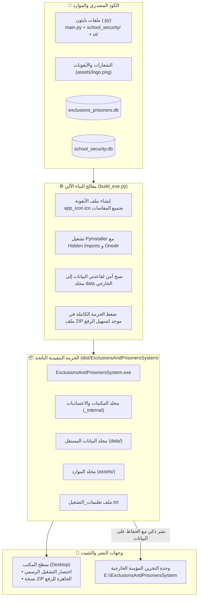

# 🚀 معمارية البناء والنشر (Deployment Architecture & Persistence Strategy)
## التطبيق المكتبي الموحد — مديرية التربية والتعليم بالإسكندرية

يوضح هذا المستند استراتيجية تحويل الكود المصدري للتطبيق إلى حزمة تنفيذية مستقلة تعمل على أي جهاز حاسوب بنظام Windows دون اشتراط تثبيت بيئة بايثون، مع ضمان الحماية المطلقة لبيانات المستخدمين وقواعد البيانات من الحذف أو الاستبدال أثناء التحديثات.

---

### 1. مخطط البناء والنشر الشامل (Build & Distribution Pipeline)



---

### 2. استراتيجية حماية قواعد البيانات وتفادي الفقد (Database Protection Strategy)

تعتبر حماية السجلات الحكومية في التطبيق أولوية قصوى. تتبع المنظومة استراتيجية صارمة مكونة من ثلاث طبقات أمان:

#### الطبقة الأولى: استقلالية مسار قاعدة البيانات أثناء التشغيل
- في الكود البرمجي (`config.py` و `school_security/config.py`)، يتم فحص حالة التشغيل:
  ```python
  if getattr(sys, 'frozen', False):
      # في حالة الحزمة المجمعة، يُعتمد مسار المجلد الخارجي بجوار ملف EXE
      BASE_DIR = Path(sys.executable).resolve().parent
  else:
      # في حالة التطوير، يُعتمد مسار مجلد المشروع
      BASE_DIR = Path(__file__).resolve().parent
  DATA_DIR = BASE_DIR / "data"
  ```
- **الفائدة:** قواعد البيانات (`exclusions_prisoners.db` و `school_security.db`) توجد خارج المجلد الداخلي المؤقت `_internal`، مما يمنع مسح البيانات عند إعادة تشغيل التطبيق أو تفريغ الملفات المؤقتة.

#### الطبقة الثانية: منع استبدال قواعد البيانات الحية عند النشر (Zero-Overwrite Policy)
- عند بناء وتحديث البرنامج ونقله إلى وحدة التخزين الخارجية `E:\ExclusionsAndPrisonersSystem`، يتحقق سكريبت `build_exe.py` مما يلي:
  ```python
  preserved_dbs = []
  if existing_db1.exists() and existing_db1.stat().st_size > 0:
      preserved_dbs.append("exclusions_prisoners.db")
  if existing_db2.exists() and existing_db2.stat().st_size > 0:
      preserved_dbs.append("school_security.db")
  ```
- إذا كانت قواعد البيانات موجودة مسبقاً وبها بيانات فعلية في القرص `E:`، يقوم السكريبت بنسخ جميع ملفات التحديث البرمجية الجديدة **مع استثناء ملفات قواعد البيانات الحية تماماً**، لضمان عدم مسح أي سجل سجله المستخدم مسبقاً.

#### الطبقة الثالثة: إنشاء قاعدة البيانات تلقائياً عند التشغيل الأول
- إذا تم تشغيل البرنامج لأول مرة على جهاز جديد تماماً وكانت قواعد البيانات غير موجودة في مجلد `data/`، تقوم كلاسات `DatabaseManager` و `SchoolSecurityDatabaseManager` بإنشاء الجداول والفهارس والعلاقات آلياً دون الحاجة لأي تدخل فني من المستخدم.

---

### 3. ملخص ملفات ومواصفات الحزمة الناتجة

| العنصر | الوصف | المسار |
|---|---|---|
| **الملف التنفيذي** | الملف الرئيسي لتشغيل المنظومة الموحدة | `ExclusionsAndPrisonersSystem.exe` |
| **قاعدة بيانات المستبعدين** | سجلات المستبعدين والمسجونين والقضايا | `data/exclusions_prisoners.db` |
| **قاعدة بيانات تأمين المدارس** | المدارس، الحراس، التكليفات، ومعدات الدفاع المدني | `data/school_security.db` |
| **الأيقونة الرسمية** | شعار النسر الذهبي المعتمد لمديرية الإسكندرية | `assets/app_icon.ico` |
| **ملف الضغط الجاهز للرفع** | أرشيف مضغوط جاهز للإرسال والتحميل السحابي | `نظام_بيانات_المستبعدين_والمسجونين_كامل.zip` |

