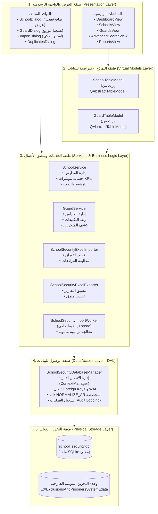

# 📐 معمارية الطبقات المتعددة (Layered Architecture)
## منظومة إدارة تأمين المدارس وحراس الأمن

تتبع المنظومة نمط الطبقات المعمارية المنفصلة (Clean Layered Architecture) الممزوج بنمط **Model-View-Delegate** المعتمد في إطار عمل Qt/PySide6، بما يضمن فصل الاهتمامات (Separation of Concerns)، وسهولة الصيانة والاختبار، وقابلية التوسع المستقبلي.

---

### 1. مخطط الطبقات الخمس (5-Layer Architecture Diagram)

---

### 2. تفصيل مسؤوليات كل طبقة (Layer Responsibilities)

#### الطبقة الأولى: طبقة العرض (Presentation Layer)
- **الموقع:** حزمة `school_security/ui/`.
- **المسؤولية:**
  - بناء وتنسيق الواجهات باستخدام عناصر PySide6 وفق نظام التصميم الملكي الموحد (Royal Blue `#1E40AF` و Midnight Slate `#0F172A`).
  - استقبال تفاعلات المستخدم (ضغط الأزرار، التمرير، الفلاتر).
  - إرسال واستقبال الإشارات (Signals/Slots) لتحديث الواجهات تزامناً مع تعديل البيانات دون تجميد واجهة المستخدم (GUI Thread).

#### الطبقة الثانية: طبقة النماذج الافتراضية (Virtual Model Layer)
- **الموقع:** `school_security/ui/table_models.py`.
- **المسؤولية:**
  - تمثيل البيانات كنموذج `QAbstractTableModel` لتزويد جداول `QTableView` بالبيانات عند الطلب فقط (Lazy Loading).
  - تحكم متقدم في المحاذاة (Alignment)، وتنسيق الأرقام، وتلوين الخلايا بحسب مؤشرات الخطر (مثال: تلوين المدارس ذات الكاميرات المعطلة أو خطوط الحريق غير المفعلة).
  - منع استهلاك الذاكرة وتفادي إنشاء آلاف عناصر `QTableWidgetItem` التقليدية.

#### الطبقة الثالثة: طبقة الخدمات ومنطق الأعمال (Services Layer)
- **الموقع:** حزمة `school_security/services/`.
- **المسؤولية:**
  - عزل منطق العمليات الحسابية والتجميعية عن الواجهات.
  - `SchoolService`: حساب مؤشرات لوحة التحكم (إجمالي الفصول، البوابات، الكاميرات العاملة/المعطلة، خراطيم وطفايات الحريق).
  - `GuardService`: التحقق من صحة الرقم القومي المكون من 14 رقماً، وكشف تكرار الأرقام أو الهواتف، وإدارة علاقات التوزيع (Assignments).
  - `ExcelImporter` و `ImportWorker`: تحليل ورقات العمل بالاعتماد على مصفوفة مرادفات مرنة تقبل الاختلافات الإملائية لأعمدة الوزارة، واستيراد البيانات ضمن معاملة برمجية ذرية (Atomic Transaction).

#### الطبقة الرابعة: طبقة الوصول للبيانات (Data Access Layer - DAL)
- **الموقع:** `school_security/database.py`.
- **المسؤولية:**
  - إدارة الاتصال الآمن مع ملف SQLite باستخدام موجه السياق `with get_connection()`.
  - تطبيق قيود التكامل المرجعي `PRAGMA foreign_keys = ON;` ونمط التسجيل المسبق للكتابة `PRAGMA journal_mode = WAL;`.
  - حقن دالة تطبيع النصوص العربية `NORMALIZE_AR` في محرك SQLite لتنفيذ استعلامات بحثية دقيقة تتجاهل الفروق بين (أ، إ، آ، ا) و (ة، ه) و (ي، ى).
  - توفير سجل تدقيق ومراقبة (Audit Logs) لتوثيق كل عمليات الإضافة والتعديل والحذف.

#### الطبقة الخامسة: طبقة التخزين المادي (Storage Layer)
- **الموقع:** مجلد `data/school_security.db`.
- **المسؤولية:**
  - الاحتفاظ بالبيانات في قرص التخزين الدائم.
  - النسخ الاحتياطي التلقائي والمزامنة عند النشر على القرص الخارجي المؤمن `E:\ExclusionsAndPrisonersSystem`.
