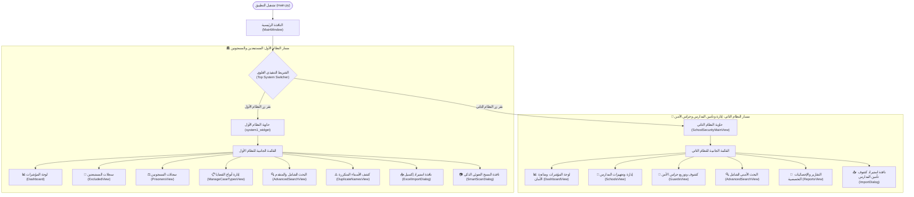

# 🧭 مسار التنقل وتدفق الشاشات (Navigation Flow & State Preservation)
## التطبيق المكتبي الموحد — مديرية التربية والتعليم بالإسكندرية

يوضح هذا المستند كيفية تنظيم مسارات التنقل للمستخدم داخل التطبيق، والآلية المتبعة للتبديل الفوري بين النظامين مع الحفاظ التام على حالة البيانات والشاشات في الذاكرة دون إعادة تحميل.

---

### 1. مخطط التنقل الرئيسي والتفريعي (Master Navigation Flowchart)



---

### 2. آليات الحفاظ على حالة الواجهات (State Preservation Mechanism)

1. **الاحتفاظ بالكائنات في الذاكرة (In-Memory Singleton Views):**
   - لا يتم تدمير (Destroy) أي شاشة عند مغادرتها.
   - يتكون مكدس الصفحات الرئيسي من كائني واجهة دائمين:
     - `self.system1_widget` (فهرس 0)
     - `self.system2_widget` (فهرس 1)
   - يتم التبديل بينهما عبر استدعاء:
     ```python
     self.master_system_stack.setCurrentIndex(system_index)
     ```
   - هذا التبديل لا يستغرق أكثر من صفر مللي ثانية ولا يتطلب إعادة قراءة البيانات من القرص الصلب.

2. **بقاء مواضع التمرير وكلمات البحث (Preserved Scroll & Query State):**
   - عندما يبحث المستخدم في جدول المدارس على كلمة "المنتزه" ويصل إلى الصف رقم 45، ثم ينتقل للنظام الأول لمراجعة سجل مستبعد، ثم يعود للنظام الثاني:
     - يظل نص البحث "المنتزه" موجوداً في حقل البحث.
     - تظل القائمة المنسدلة للإدارة كما هي محددة.
     - يظل الجدول متوقفاً عند نفس الصف ومحتفظاً بالتحديد (Selection).

3. **التحديث الذكي عند وقوع تغييرات حقيقية (Event-Driven Refresh):**
   - لا يُعاد استدعاء قواعد البيانات عشوائياً عند مجرد التبديل بين الشاشات.
   - يتم التحديث فقط عند إطلاق إشارة `data_changed` إثر إضافة سجل جديد، أو تعديله، أو إتمام استيراد إكسيل، مما يوفر أقصى سرعة واستجابة ممكنة للتطبيق.
