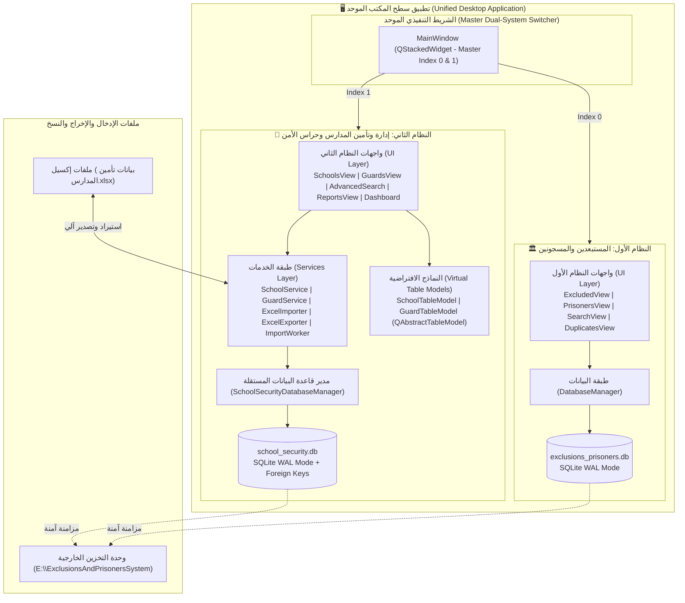

# 🏛️ وثيقة المعمارية العامة للنظام (System Architecture Document)
## مديرية التربية والتعليم بالإسكندرية — المنظومة الرقمية الموحدة

---

### 1. نظرة عامة على النظام (Executive Overview)
تجمع هذه المنظومة بين نظامين حكوميين متكاملين ومستقلين تماماً في تطبيق مكتبي واحد موحد (Unified Single Desktop Application) مبني باستخدام **Python 3.12** و **PySide6 (Qt for Python)**، مع اعتماد واجهات رسومية تنفيذية متطورة تدعم اللغة العربية واتجاه العرض من اليمين إلى اليسار (Native RTL):

1. **نظام بيانات المستبعدين والمسجونين (System 1: Exclusions & Prisoners System):**
   - متابعة السجلات الأمنية والقضائية للعاملين بمديرية التربية والتعليم بالإسكندرية.
   - كشف التكرارات والأسماء المتشابهة، وتصنيف القضايا والمخالفات.
   - مسح ضوئي ذكي للمستندات والقرارات واستخراج البيانات عبر الذكاء الاصطناعي (Gemini Vision OCR).
   - قاعدة البيانات المستقلة: `data/exclusions_prisoners.db`.

2. **منظومة إدارة تأمين المدارس وحراس الأمن (System 2: School Security Management System):**
   - حصر وتوثيق الحالة الإنشائية والأمنية لمدارس المحافظة (المنشآت، البوابات، الفصول، التبعية).
   - إدارة تجهيزات الإطفاء والدفاع المدني (طفايات، خطوط حريق مفعلة/غير مفعلة، خراطيم صالحة/تالفة، جرادل رمل).
   - متابعة منظومات المراقبة التلفزيونية والكاميرات (الكاميرات العاملة والمعطلة، شركات الصيانة المتعاقدة).
   - إدارة وتوزيع عمال وحراس الأمن المدرسي وربطهم بالمدارس والإدارات التعليمية.
   - محرك استيراد ذكي من كشوف الإكسيل مع المطابقة الذكية للأسماء والإدارات.
   - قاعدة البيانات المستقلة: `data/school_security.db`.

---

### 2. المخطط المعماري العام للنظام (Overall System Architecture)

---

### 3. مبادئ التصميم والمعمارية (Key Architectural Principles)

1. **الاستقلالية التامة لقواعد البيانات (Strict Database Isolation):**
   - تم الفصل الكامل بين قاعدة بيانات المستبعدين `exclusions_prisoners.db` وقاعدة بيانات تأمين المدارس `school_security.db`.
   - لا تتشارك العمليات أي جداول أو اتصالات لتجنب أي تداخل في السجلات الحساسة.

2. **عدم إعادة البناء والحفاظ على الحالة (State Preservation):**
   - يتم التبديل بين النظامين عبر `QStackedWidget` مركزي رئيسي دون تدمير أو إعادة بناء الكائنات في الذاكرة.
   - يحتفظ المستخدم بمدخلات البحث ومواضع التمرير (Scroll Positions) والمرشحات النشطة عند التنقل.

3. **النماذج الافتراضية عالية الأداء (Virtualized Virtual Models):**
   - تم استخدام `QAbstractTableModel` بدلاً من `QTableWidget` لعرض آلاف سجلات المدارس والحراس بسرعة استجابة تقل عن بضعة أجزاء من الثانية.

4. **المعالجة في الخلفية بدون تجميد (Non-Blocking Concurrency):**
   - عمليات استيراد كشوف الإكسيل الكبيرة تعمل عبر خيط عمل مستقل `QThread` (`SchoolSecurityImportWorker`) يرسل إشارات دورية بالتقدم ونسبة الإنجاز للواجهة.

5. **المطابقة الذكية للنصوص العربية (Smart Arabic Normalization):**
   - دوال مطابقة وتطبيع مخصصة في محرك SQLite (`NORMALIZE_AR`) لتوحيد الهمزات والتاء المربوطة والياء وإزالة التشكيل، لضمان دقة ربط الحراس بالمدارس.

